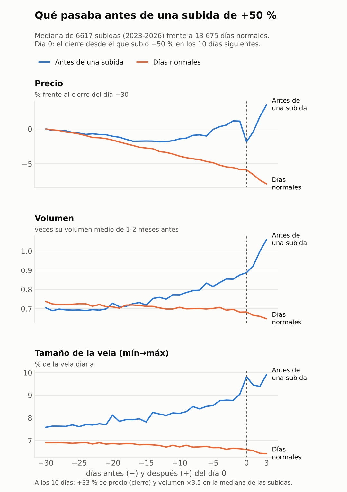

# Qué tenían en común las monedas antes de subir +50 %

Análisis del 2 de noviembre de 2026. Pregunta: antes de llegar a +50 %, ¿qué tenían en común las monedas en la
forma de las velas, los patrones, la tendencia, el volumen (sus MA(5) y MA(25)) y la acumulación?

## Resumen

Las que subieron +50 % no se parecían por **la forma de la vela** ni por los **patrones clásicos** (martillo,
envolvente, doji, vela interior): con ellos sube casi la misma proporción que sin ellos. Tampoco por la
**compresión** o la **acumulación silenciosa**: las bandas de Bollinger estrechas, el precio lateral y el OBV
subiendo con el precio plano eran *menos* frecuentes antes de subir, y el CMF da resultados distintos según el
grupo. Lo único parecido a acumulación que aparece es que haya más volumen en las velas verdes (1,2-1,4 veces la
media), que va con un precio que ya empieza a subir.

Lo que sí tenían en común, todos los años y también dentro de las listas de Momento-A y Momento-B, es que **ya
eran monedas en movimiento**:

1. **Velas grandes y volatilidad alta** (una vela de 15 % o más de mínimo a máximo: 2,2 veces la media).
2. **Volumen que crece** (MA(5) ≥ 1,75 × MA(25): 1,7-1,9 veces la media), no volumen que se apaga.
3. **Precio que ya empezaba a subir**: rompe su máximo de 20 días o va +30 % sobre su mínimo de 30 días (1,4-1,9
   veces). Estar sobre una MA(25) que sube ayuda en todas las monedas (1,5 veces), pero poco dentro de las listas
   (1,2 veces).
4. **Explosiones recientes**: muchas velas de +10 % en el último mes (1,5 veces).
5. **Monedas jóvenes**: listadas hace menos de 6 meses (1,9 veces).

En los 30 días anteriores, el precio se mantenía **plano o subiendo un poco** mientras el volumen y el tamaño de las
velas **crecían poco a poco**; en los días normales el precio iba bajando y el volumen se apagaba. Y cuantos más de
estos rasgos tiene una moneda, más sube: con 5 o más, el 17,8 % llega a +50 % (3 veces la media). **Pero las caídas
de −20 % también pasan del 12 % al 45 %**: son monedas explosivas en las dos direcciones.

No hay un patrón que tengan todas: entre el 20 y el 30 % de las que llegaron a +50 % no tenía ninguno de estos rasgos.

## Cómo se midió

- Velas diarias de Binance (abren a las 00:00 UTC) de 751 monedas desde 2023, también las que Binance ya retiró;
  si una moneda está en spot y en futuros cuenta una vez (futuros, como la red). En total, 652 691 días.
- Cada rasgo se mide **con lo que se sabía al cierre de la vela del día** (la del día de la lista).
- **Subió** = el máximo de las 10 velas diarias siguientes llega a +50 % sobre la apertura de la siguiente, igual
  que las etiquetas de la red. 37 051 días (5,7 %), en 7014 subidas distintas.
- **«En común» se mide frente a los días en que no subió**: un rasgo que tenían muchas de las que subieron no dice
  nada si lo tenían igual de a menudo los días normales. *Veces la media* = con ese rasgo, cuántas veces más (o
  menos) de lo normal llegó a +50 %. Se mira también cada año por separado y dentro de las candidatas de
  Momento-A y Momento-B (183 325 días).
- **Una trampa evitada:** si se mira solo el *primer* día de cada subida, sale que el día antes la vela era roja
  (solo el 22 % verdes). En parte es mecánico: el primer día desde el que se llega a +50 % suele ser uno en que el
  precio bajó un poco. Por eso las tablas usan todos los días desde los que se llegó a +50 %.

## La forma antes de subir

Mediana de 6617 subidas frente a 13 675 días normales tomados al azar (días desde los que no subió ni +20 %).
Precio: % frente al cierre 30 días antes. Volumen: veces su media de 1-2 meses antes. Día 0: el cierre desde el
que subió +50 % en los 10 días siguientes.

## Cuantos más rasgos, más sube (y más cae)

Los ocho rasgos: vela de 15 % o más, volatilidad de 14 días ≥ 7 %, MA(5) ≥ 1,75 × MA(25) del volumen, listada hace
menos de 6 meses, rompe su máximo de 20 días, +30 % sobre su mínimo de 30 días, 10 o más velas de +10 % en 30 días,
y precio sobre una MA(25) que sube.

| Rasgos que tenía ese día | Parte de los días | Llegó a +50 % | Veces la media | Cayó −20 % | 2023 | 2024 | 2025 | 2026 |
|---|---:|---:|---:|---:|---:|---:|---:|---:|
| 0 | 38 % | 2,9 % | 0,5× | 11,7 % | 2,9 % | 3,4 % | 2,5 % | 3,1 % |
| 1 | 24 % | 4,3 % | 0,8× | 16,8 % | 4,5 % | 3,7 % | 4,1 % | 5,0 % |
| 2 | 16 % | 6,1 % | 1,1× | 20,9 % | 6,3 % | 6,1 % | 5,3 % | 7,0 % |
| 3 | 10 % | 8,2 % | 1,5× | 26,2 % | 8,7 % | 7,4 % | 7,7 % | 9,7 % |
| 4 | 7 % | 11,4 % | 2,0× | 34,3 % | 10,3 % | 9,8 % | 11,3 % | 14,0 % |
| 5 o más | 5 % | 17,8 % | 3,1× | 45,1 % | 16,3 % | 13,6 % | 17,8 % | 22,2 % |

En las candidatas de Momento-A y Momento-B pasa lo mismo: del 3,8 % sin ninguno al 16,3 % con 5 o más (y las caídas
de −20 %, del 11,8 % al 43,3 %).

## Todos los rasgos

| Rasgo el día de la lista | Lo tenían las que subieron | Lo tenían los días normales | Veces la media (todas) | Por año 2023-2026 | Veces la media (candidatas Momento-A/B) |
|---|---:|---:|---:|---|---:|
| **La vela del día** | | | | | |
| Vela verde | 50,4 % | 44,5 % | 1,12× | 1,1 · 1,1 · 1,1 · 1,2 | 1,00× |
| Vela con rango ≥ 15 % (mín→máx) | 26,6 % | 11,0 % | 2,23× | 2,3 · 1,8 · 2,1 · 2,7 | 2,20× |
| Martillo (mecha inferior larga) | 4,9 % | 5,2 % | 0,93× | 1,0 · 0,9 · 0,8 · 1,0 | 0,96× |
| Estrella fugaz (mecha superior larga) | 8,1 % | 6,4 % | 1,25× | 1,2 · 1,0 · 1,3 · 1,3 | 1,12× |
| Doji (cuerpo casi nulo) | 11,2 % | 10,5 % | 1,06× | 1,0 · 1,0 · 1,1 · 1,1 | 1,05× |
| Marubozu verde (casi todo cuerpo) | 1,9 % | 1,5 % | 1,24× | 1,2 · 1,1 · 1,1 · 1,7 | 1,03× |
| Envolvente alcista | 8,6 % | 7,4 % | 1,15× | 1,1 · 1,1 · 1,1 · 1,3 | 1,02× |
| Vela interior (dentro de la anterior) | 18,5 % | 17,0 % | 1,08× | 1,0 · 1,1 · 1,1 · 1,2 | 0,98× |
| 3+ velas verdes seguidas | 12,2 % | 9,3 % | 1,28× | 1,3 · 1,3 · 1,2 · 1,4 | 1,07× |
| 3+ velas rojas seguidas | 13,0 % | 18,8 % | 0,70× | 0,8 · 0,9 · 0,8 · 0,5 | 1,00× |
| **Tendencia** | | | | | |
| Precio sobre la MA(25) y MA(25) subiendo | 41,0 % | 26,8 % | 1,49× | 1,5 · 1,6 · 1,4 · 1,4 | 1,16× |
| Medias alcistas (MA7 > MA25 > MA99) | 26,9 % | 17,1 % | 1,52× | 1,6 · 1,7 · 1,0 · 1,7 | — (las reglas de Momento-A y B no lo permiten) |
| Medias bajistas (MA7 < MA25 < MA99) | 30,6 % | 38,3 % | 0,81× | 0,5 · 0,6 · 0,9 · 0,9 | 0,92× |
| Rompe el máximo de 20 días | 6,0 % | 3,0 % | 1,87× | 1,9 · 1,8 · 1,8 · 2,0 | 1,49× |
| Ya +30 % sobre su mínimo de 30 días | 45,2 % | 26,0 % | 1,67× | 1,8 · 1,4 · 1,5 · 2,1 | 1,41× |
| Más de −80 % bajo su máximo de 1 año | 33,9 % | 28,1 % | 1,19× | 0,9 · 1,3 · 1,3 · 1,1 | 1,46× |
| **Compresión y acumulación** | | | | | |
| Bandas de Bollinger estrechas (20 % más bajo de su historia) | 17,2 % | 22,9 % | 0,76× | 0,6 · 0,6 · 0,8 · 0,8 | 0,89× |
| Rangos recientes más pequeños (5 d < 70 % de 30 d) | 17,2 % | 19,6 % | 0,88× | 0,8 · 0,5 · 1,1 · 1,0 | 0,86× |
| Lateral: rango de 20 días < 25 % | 9,2 % | 22,7 % | 0,42× | 0,5 · 0,6 · 0,3 · 0,4 | 0,67× |
| Acumulación: CMF(20) > 0,1 | 19,2 % | 15,1 % | 1,26× | 1,1 · 1,4 · 1,0 · 1,6 | 0,93× |
| Acumulación oculta: OBV sube y precio plano (±10 %) | 9,3 % | 10,1 % | 0,92× | 0,9 · 0,9 · 1,0 · 0,9 | 0,94× |
| Más volumen en velas verdes (> 60 % en 20 d) | 39,5 % | 26,9 % | 1,43× | 1,4 · 1,5 · 1,5 · 1,4 | 1,23× |
| **Volumen (MA(5) y MA(25))** | | | | | |
| MA(5) < MA(25) del volumen 3+ días | 43,8 % | 48,9 % | 0,90× | 0,8 · 0,7 · 1,0 · 1,0 | 0,85× |
| MA(5) ≥ 1,75 × MA(25) del volumen | 16,3 % | 8,2 % | 1,89× | 1,6 · 2,2 · 2,0 · 1,9 | 1,73× |
| MA(25) del volumen > MA(99) (volumen creciendo meses) | 33,2 % | 23,1 % | 1,40× | 1,4 · 1,5 · 1,4 · 1,4 | 1,36× |
| Compras agresivas > 55 % (7 d) | 0,4 % | 0,7 % | 0,58× | 0,5 · 0,4 · 0,5 · 0,7 | 0,72× |
| **Volatilidad e historial** | | | | | |
| Volatilidad 14 d ≥ 7 % | 34,0 % | 15,4 % | 2,06× | 2,3 · 1,6 · 2,0 · 2,4 | 2,00× |
| 10+ velas de +10 % en los últimos 30 días | 54,8 % | 34,9 % | 1,52× | 1,6 · 1,2 · 1,5 · 1,9 | 1,53× |
| Una vela de +50 % (mín→máx) en los últimos 90 días | 51,7 % | 35,0 % | 1,44× | 1,6 · 1,2 · 1,4 · 1,6 | 1,39× |
| Ya tuvo un +50 % en 10 días en los últimos 3 meses | 66,1 % | 49,9 % | 1,30× | 1,3 · 1,2 · 1,2 · 1,5 | 1,28× |
| **La moneda** | | | | | |
| Listada hace menos de 6 meses | 19,9 % | 10,2 % | 1,85× | 1,3 · 1,3 · 2,2 · 1,8 | 1,96× |
| Volumen diario > 10 M USDT (media 7 d) | 31,6 % | 23,4 % | 1,33× | 1,2 · 1,2 · 1,3 · 1,7 | 1,13× |
| Volumen diario < 1 M USDT | 18,8 % | 29,5 % | 0,65× | 0,8 · 0,7 · 0,6 · 0,6 | 0,89× |
| Precio < 0,01 USDT | 15,1 % | 13,9 % | 1,08× | 1,1 · 1,5 · 1,0 · 0,9 | 1,24× |
| Futuros (no solo spot) | 36,2 % | 28,1 % | 1,27× | 0,9 · 1,0 · 1,4 · 1,2 | 1,55× |
| **Mercado** | | | | | |
| Más de la mitad de las monedas sobre su MA(25) | 38,9 % | 32,3 % | 1,19× | 1,3 · 1,5 · 1,0 · 1,0 | 1,07× |
| BTC subió > 5 % en 7 días | 22,8 % | 19,2 % | 1,18× | 1,2 · 1,4 · 1,0 · 1,1 | 1,06× |
| BTC bajo su MA(25) | 41,1 % | 47,8 % | 0,87× | 0,7 · 0,6 · 0,9 · 1,0 | 0,86× |

## Qué quiere decir

- **Busca movimiento, no calma.** Las subidas de +50 % salieron de monedas que ya se movían: velas grandes,
  volumen creciendo y precio dejando de caer. La idea de «acumulación silenciosa antes de explotar» (precio lateral,
  bandas estrechas, poco volumen) no aparece en los datos: con el precio lateral 20 días sube bastante menos que la
  media (0,42 veces en todas las monedas y 0,67 en las candidatas).
- **Las velas sueltas no dicen casi nada.** Martillo, doji, envolvente o vela interior dan entre 0,9 y 1,2 veces la
  media. Lo que importa de la vela es su **tamaño**, no su forma.
- **Las MA(5) y MA(25) del volumen sirven al revés de lo que parecía:** la MA(5) por encima de la MA(25) (volumen
  creciendo) es lo que aparece antes de las subidas.
- **El riesgo va con el premio.** Los mismos rasgos que multiplican las subidas multiplican las caídas: casi la
  mitad de las monedas con 5 o más rasgos cayó un 20 % en algún momento de los 10 días.
- **La red ya mira casi todo esto** (tamaño de la vela, volatilidad, explosiones recientes, distancia al mínimo,
  edad, volumen relativo), por eso ordena bien las monedas. Algunos rasgos no los tiene tal cual (romper el
  máximo de 20 días, el volumen creciendo durante meses, la parte del volumen en velas verdes); se puede probar si
  le añaden algo, como se hizo con las medias del volumen.
